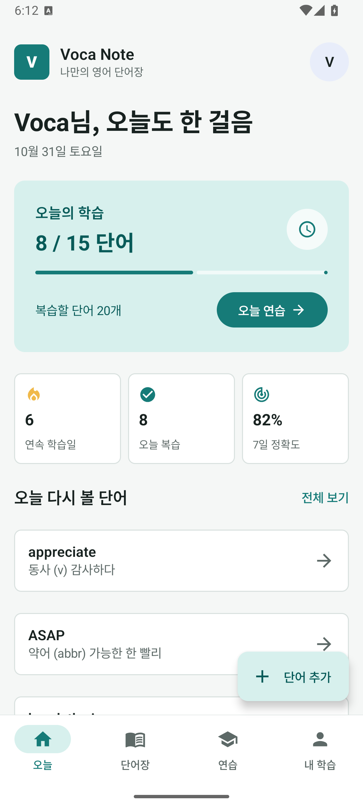
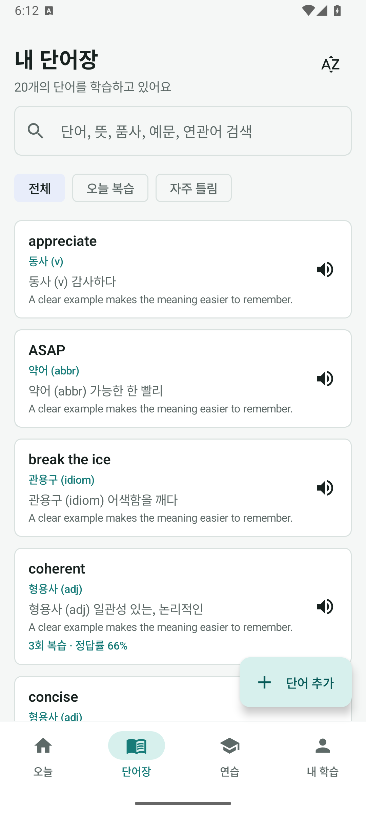
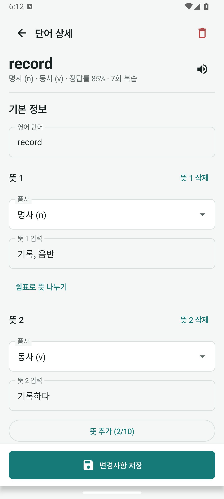
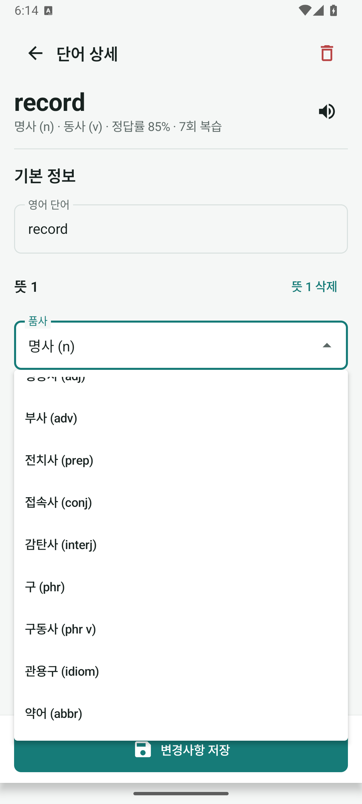
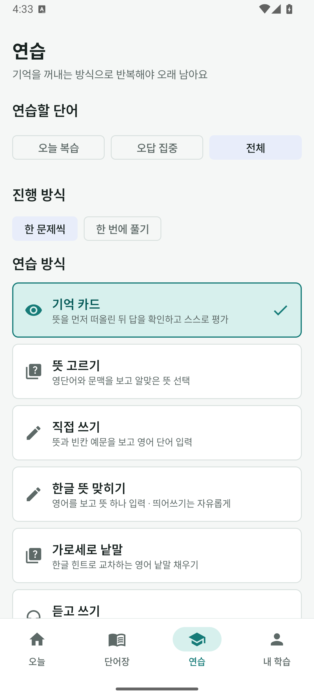
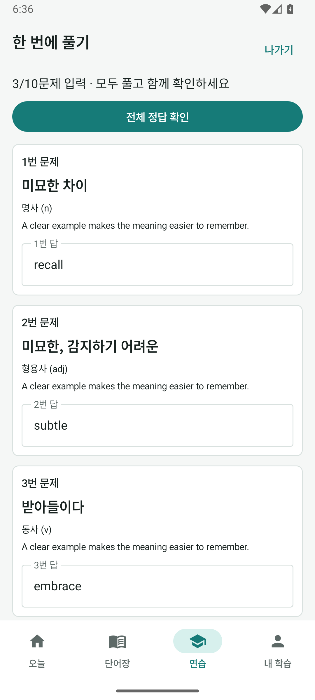
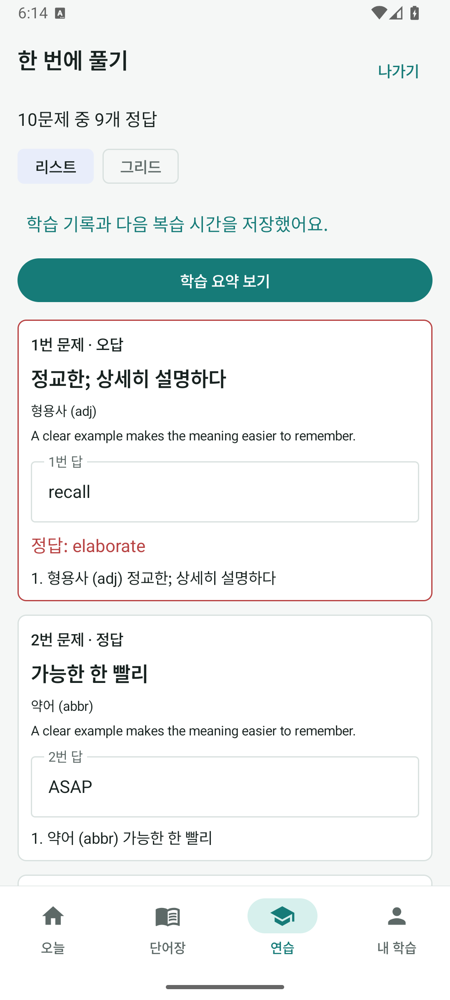
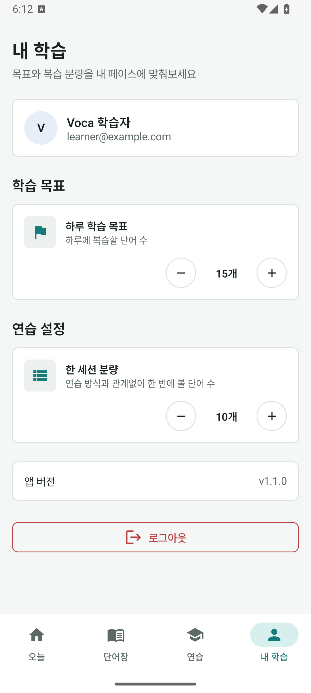
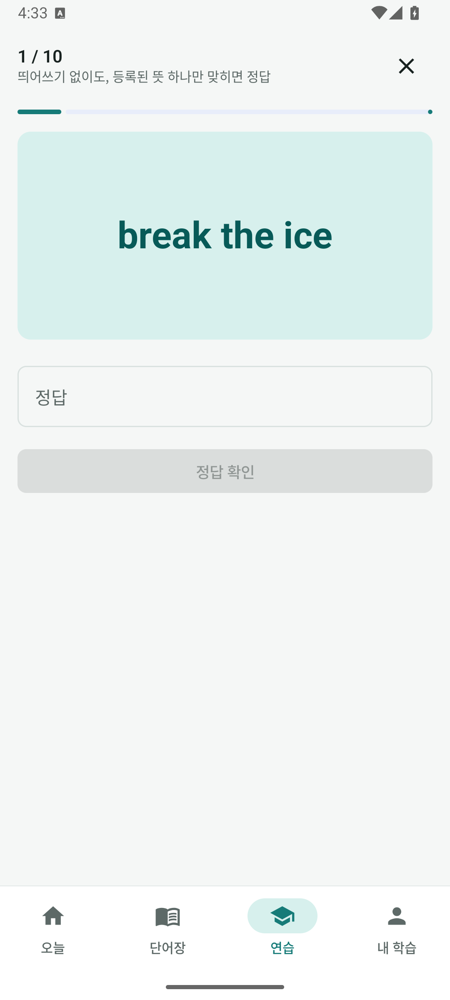
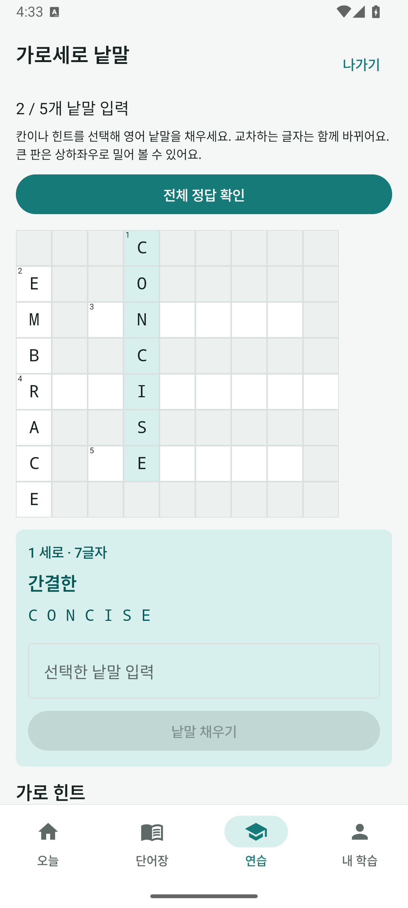

<div align="center">
  <h1>Voca Note · Android</h1>
  <p><strong>직접 모은 단어를 웹과 함께 기록하고, 쓰고, 듣고, 다시 기억하는 영어 학습 앱</strong></p>
  <p>
    <a href="https://voca-note.web.app">웹에서 시작하기</a> ·
    <a href="https://github.com/JeHeeYu/Voca-Note-Web">웹 저장소</a> ·
    <a href="CHANGELOG.md">변경 기록</a>
  </p>
  <p>Kotlin · Jetpack Compose · Material 3 · Firebase Auth / Firestore · Android 7.0+</p>
</div>

앱과 웹에서 같은 Google 계정으로 로그인하면 단어, 뜻별 품사, 학습 설정과 복습 기록을 이어서 사용할 수 있습니다. **현재 버전은 1.2.1**입니다.

## 화면

아래 이미지는 실제 Android 앱의 **샘플 데이터 화면**입니다. 로그인이나 개인 단어장 데이터를 사용하지 않습니다.

<table>
  <tr>
    <td align="center" width="50%"><br><strong>오늘의 학습</strong><br>목표, 연속 학습일, 복습할 단어</td>
    <td align="center" width="50%"><br><strong>단어장</strong><br>모든 뜻·품사·연관어 검색과 정렬</td>
  </tr>
  <tr>
    <td align="center"><br><strong>뜻별 편집</strong><br>뜻 추가·삭제, 뜻마다 품사 지정</td>
    <td align="center"><br><strong>품사와 표현</strong><br>8품사 + 구·구동사·관용구·약어</td>
  </tr>
  <tr>
    <td align="center"><br><strong>연습 설정</strong><br>한 문제씩 또는 한 번에, 5~30문제 선택</td>
    <td align="center"><br><strong>한 번에 풀기</strong><br>문제를 아래로 이어서 풀고 일괄 채점</td>
  </tr>
  <tr>
    <td align="center"><br><strong>답안 비교</strong><br>모든 뜻 확인, 오답 재연습, 저장 재시도</td>
    <td align="center"><br><strong>내 학습</strong><br>하루 목표와 기본 문제 수</td>
  </tr>
  <tr>
    <td align="center"><br><strong>한글 뜻 맞히기</strong><br>띄어쓰기 없이도 뜻 하나만 맞히면 정답</td>
    <td align="center"><br><strong>가로세로 낱말</strong><br>내 단어장으로 만든 한글 힌트 게임</td>
  </tr>
</table>

## 기능

| 영역 | 제공 기능 |
| --- | --- |
| 단어 입력 | 저장 후 추가 화면 유지, 최대 10개 뜻, 뜻마다 품사 지정, 뜻 추가·삭제·쉼표 분리 |
| 품사·표현 | 명사·대명사·동사·형용사·부사·전치사·접속사·감탄사, 구(phr)·구동사(phr v)·관용구·약어 |
| 연관 정보 | 예문, 메모, 유의어·반의어·파생어·혼동어·숙어/연어, 기기 TTS |
| 탐색 | 모든 뜻과 품사·예문·연관어 검색, 복습/오답 필터, 최근/알파벳/학습 우선순 정렬 |
| 한 문제씩 | 기억 카드·뜻 고르기·직접 쓰기·듣고 쓰기, 정답 확인 후 Enter로 다음 문제 |
| 한 번에 풀기 | 뜻 고르기·직접 쓰기·듣고 쓰기, 5~30문제, 세로로 이어지는 문제, 빈 답 검증, 일괄 채점 |
| 한글 뜻 맞히기 | 한 문제씩·일괄 풀이, 등록된 여러 뜻 중 하나 인정, 띄어쓰기·유니코드 정규화, 쉼표·세미콜론·슬래시로 나눈 뜻 지원 |
| 가로세로 낱말 | 한글 힌트, 교차 글자 공유, 연결된 낱말판, 빈칸 검증·일괄 채점·오답 직접 쓰기 |
| 출제 범위 | 전체는 등록일·정답률·복습일과 무관하게 동일 확률로 출제, 오늘 복습·오답 집중은 복습 우선순위 유지 |
| 결과 | 전체 답안 다시 보기, 틀린 단어 재연습, 저장 실패 시 답안을 유지해 재시도 |
| 간격 반복 | 정답 `1일 → 3일 → 이전 간격의 2배(최대 180일)`, 오답 `10분` |
| 동기화 | 앱·웹 공통 Google 계정, 사용자별 Firestore 실시간 동기화, 중복 저장 방지 |

한 번의 연습에서는 같은 단어를 중복 출제하지 않습니다. 전체 범위는 매번 무작위로 뽑으므로 다른 연습에서 같은 단어를 다시 만날 수 있습니다. 풀이 중 실시간 데이터가 변경되어도 시작할 때 고른 문제와 입력한 답은 유지합니다.

한글 뜻은 입력과 저장된 뜻을 같은 구분자로 나눠 비교하며, 순서와 띄어쓰기는 무시합니다. `보상금, 보상`을 등록했다면 `보상`, `보상금`, `보상, 보상금` 모두 정답입니다. 뜻별로 따로 등록한 경우도 같고, 여러 뜻 중 일부만 입력해도 됩니다. 여러 개를 입력할 때는 입력한 항목이 모두 등록된 뜻이어야 하며, 등록하지 않은 유의어나 활용형은 자동 추측하지 않습니다.

가로세로 게임은 영문 2~18글자를 사용하며 공백·하이픈·아포스트로피는 칸에서 생략합니다. 최대 25×25칸에서 실제로 교차하는 단어를 배치하므로 설정한 문제 수보다 적게 출제될 수 있습니다. 연결 가능한 단어가 두 개 미만이면 안내 후 시작하지 않습니다. 두 모드는 `meaning_writing`, `crossword`로 Firebase에 저장하고 기존 복습 간격과 중복 저장 방식을 유지합니다.

## 구조

```text
app/src/main/java/com/example/vocanote
├── auth/                 # Credential Manager + Firebase Auth
├── core/
│   ├── data/             # VocaRepository / FirestoreVocaRepository
│   ├── designsystem/     # 공통 레이아웃과 UI 컴포넌트
│   ├── model/            # 단어·뜻·품사, 통계, 간격 반복
│   └── speech/           # Android TTS
├── features/
│   ├── editor/           # 뜻별 입력, 검증, 연속 저장
│   ├── home/             # 목표와 복습 대상
│   ├── library/          # 검색·필터·정렬
│   ├── review/           # 출제 엔진, 세션 ViewModel, 단일·일괄 풀이
│   └── settings/         # 학습량과 계정
└── ui/                   # 로그인·구독 상태, Navigation 조립
```

화면은 Firebase SDK를 직접 호출하지 않습니다. 전역 `VocaNoteViewModel`이 계정과 데이터 구독을 관리하고, `ReviewSessionViewModel`이 풀이 중인 문제·답안·저장 상태를 보존합니다. 문제 생성·뜻 정규화·채점·간격 반복은 JVM 테스트로 확인합니다.

## 앱·웹 공통 데이터

Firebase 프로젝트는 `voca-note-1068c`입니다.

```text
users/{uid}/words/{wordId}
  word, wordLowercase, meanings[{meaning, partOfSpeech}]
  meaning, partOfSpeech, example, note
  synonyms, antonyms, derivatives, confusableWords, collocations
  correctCount, incorrectCount, reviewStreak, reviewIntervalDays
  createdAt, updatedAt, lastReviewedAt, nextReviewAt

users/{uid}/settings/review
  sessionSize, dailyGoal, updatedAt

users/{uid}/reviewSessions/{sessionId}
  mode, questionCount, correctCount
  wordIds, incorrectWordIds, completedAt
```

`meanings` 배열이 있으면 이를 기준으로 읽고 편집합니다. 기존 단일 `meaning` 문서는 하나의 뜻으로 읽으며 쉼표를 자동 분리하지 않습니다. 저장할 때 첫 뜻·품사를 기존 단일 필드에도 반영합니다. 뜻은 1~10개, 각각 최대 300자입니다. 품사 저장 값은 기존 8개와 `phrase`, `phrasal_verb`, `idiom`, `abbreviation`입니다.

단어 통계와 학습 세션은 **하나의 Firestore transaction**으로 저장합니다. 같은 세션 ID로 재시도해도 중복 집계하지 않으며, 다른 기기에서 변경된 최신 학습 간격을 읽어 다음 복습일을 계산합니다. 풀이 중 단어가 삭제된 경우 세션을 일부만 저장하지 않습니다.

[`firestore.rules`](firestore.rules)는 웹 저장소와 같은 규칙입니다. 스키마를 바꾸면 두 저장소의 규칙을 함께 갱신하고 공용 프로젝트에 배포하세요. 현재 버전의 여러 뜻 기능은 이미 배포된 규칙을 사용합니다.

## 실행

1. Android Studio와 **JDK 21**, Android SDK 36.1을 준비합니다. Gradle wrapper는 9.3.1입니다.
2. 기존 Firebase Android 앱 설정을 `app/google-services.json`에 둡니다. 이 파일은 커밋하지 않습니다.
3. Google 로그인을 활성화하고 개발용 서명 인증서의 SHA-1/SHA-256을 Firebase에 등록합니다.
4. Android API 24 이상 기기에서 실행합니다.

```sh
./gradlew assembleDebug
adb install -r app/build/outputs/apk/debug/app-debug.apk
```

`-r`로 업데이트하면 동일한 서명의 기존 앱 데이터를 유지합니다. 설치된 앱과 서명이 다르면 앱을 삭제하기 전에 서명 설정부터 확인하세요. Release APK는 별도 배포 서명이 필요합니다.

무선 디버깅은 휴대폰에 표시되는 현재 주소·포트와 코드를 사용합니다. 페어링 포트와 연결 포트는 서로 다릅니다.

```sh
adb pair <페어링-IP:포트>       # 화면에 표시되는 일회용 코드 입력
adb connect <연결-IP:포트>
adb devices -l
```

## 검증과 화면 촬영

```sh
./gradlew testDebugUnitTest lintDebug assembleDebug assembleRelease
./gradlew assembleDebugAndroidTest
adb install -r app/build/outputs/apk/androidTest/debug/app-debug-androidTest.apk
adb shell am instrument -w com.example.vocanote.test/androidx.test.runner.AndroidJUnitRunner
```

기기 UI 테스트는 로그인 없이 테스트용 데이터로 여러 뜻 입력, 연속 추가, Enter 진행, 20문제 일괄 채점, 스크롤 중 답안 유지, 한글 뜻 채점, 가로세로 퍼즐 완주, 저장 실패 재시도를 확인합니다. 테스트할 기기는 잠금을 풀어 두어야 합니다.

Debug 전용 UI 카탈로그는 개인 계정과 연결되지 않습니다. Release 빌드에는 포함되지 않습니다.

```sh
adb shell am start -n com.example.vocanote/.debug.UiCatalogActivity --es screen editor
# screen: home, library, review, settings, editor, new-editor, worksheet, worksheet-results
python3 scripts/capture-screenshots.py --serial <adb-device-id>
```

스크린샷에는 카탈로그의 샘플 데이터만 사용합니다. 실제 Google 로그인과 TTS 음성 출력은 기기 및 계정 설정에 따라 별도로 확인합니다.
